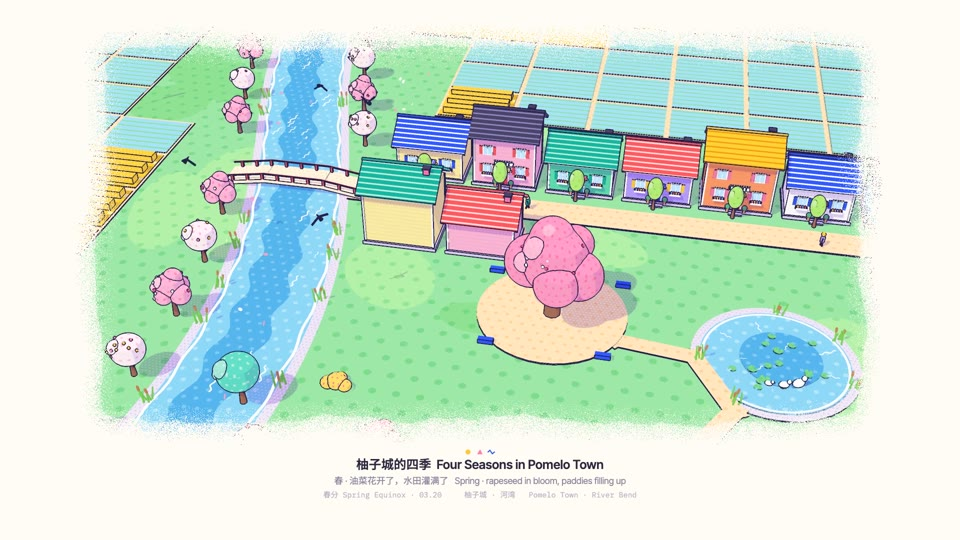
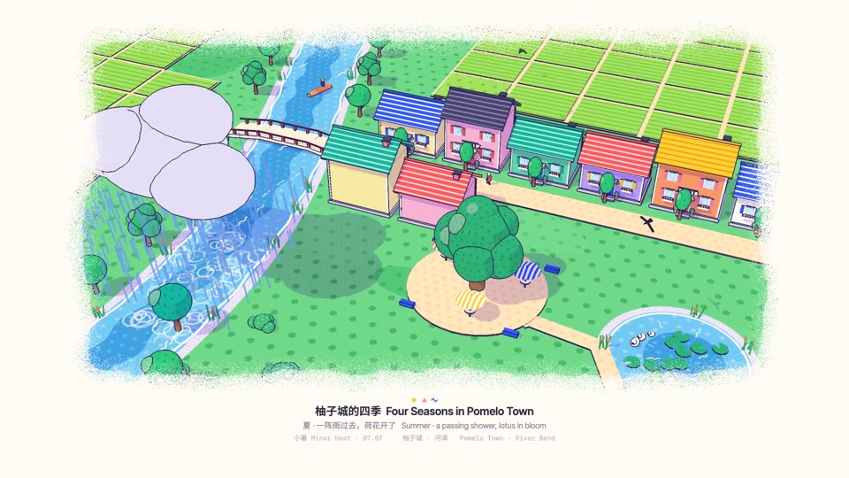
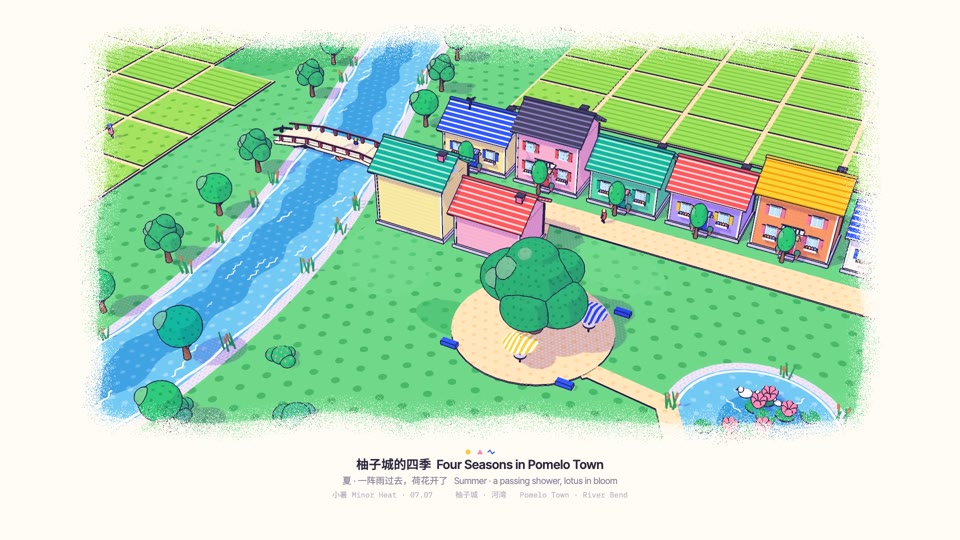
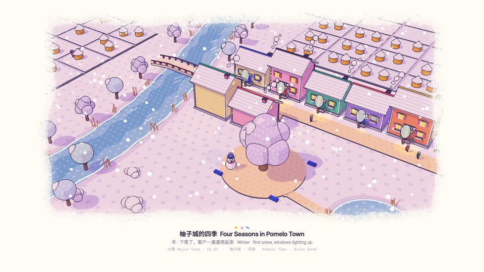

# Memphis Diorama — our demo

One example among many. Don't reuse its story, arc, shots, props or timings.

Demo: *Four Seasons in Pomelo Town* (柚子城的四季, 45 s) · `memphis-diorama.mp4` · source in [`demo/`](demo/)

## Story & structure

One fictional river bend (a river, a bridge, a lane of ten houses, a plaza with one big tree, a lotus pond, fields) goes through spring, summer, autumn and winter in one take, ten seconds each, then holds on the lit winter village for the end card. There is no protagonist: the place is the subject, and the seasons are told only by colour and by small motions.

Every change of season is the same gesture, so the film reads as one piece: **the big tree on the plaza squats down for half a second, springs back, and a wave spreads from it**. Inside the ring the ground, crowns, roofs and water take the next season's colours; as the ring passes, objects act (rows of rape flowers sink, umbrellas open or fold, haystacks pop up, snow starts).

| Season | Time | What changes | Small motions |
|---|---|---|---|
| Spring | 0–10 s | rape fields yellow, paddies flooded sky blue, pink and white blossom with flower dots | petals drift east, kites, swallows, ducks, a boat |
| Summer | 10–20 s | rice green, crowns deep green, three parasols open | a grey-lilac cloud crosses with rain and ripples, then eight lotus flowers open one by one |
| Autumn | 20–30 s | rice gold, grass yellow-green, crowns red, orange and yellow | haystacks pop up field by field, leaves fall, a V of geese flies south-west, swallows leave, lotus wilts |
| Winter | 30–39 s | snow ground, white roofs and haystack caps, pastel crowns with white dots, lilac field ridges | snow, chimney smoke, a snowman appears; from 34 s dusk turns the picture pink-violet and every window and door lamp lights up at its own moment |

 
 

## Shots

One take. The camera orbits the plaza at fov 30°, high and slowly closing in; after 18 s it eases down to 0.3× speed so the pond and the village stay in frame through autumn, winter and the end card.

| # | Time | Shot | Camera | Native move / note |
|---|---|---|---|---|
| 1 | 0–1.2 s | the frame grows open on spring | orbit starts, 92 m out, 70 m up | Grow the frame |
| 2 | 1.2–9.3 s | spring: petals, kites, swallows, ducks | slow orbit | Living loop |
| 3 | 8.8–11.9 s | the tree squats (8.8–9.3), springs back, the summer wave spreads | — | Squash and spring → Wave |
| 4 | 11.2–19.2 s | the rain cloud crosses west to east; rain 12.2–17.8 s; lotus 16.6–17.8 s | — | |
| 5 | 18.8–21.9 s | the squat again; the autumn wave | the camera eases to 0.3× speed | Squash and spring → Wave |
| 6 | 21.2–30.6 s | geese cross; haystacks pop 22–27.5 s; leaves fall | slow orbit | |
| 7 | 28.8–31.9 s | the squat again; the winter wave, snow starts behind it | — | Squash and spring → Wave |
| 8 | 32.6 s | a snowman bounces in on the plaza | — | |
| 9 | 33.8–38.3 s | dusk; windows and door lamps light one by one, warm pools on the lane | — | |
| 10 | 39.3–44 s | end card: lines 2 and 3 of the bottom type change to the sign-off and the style name, over the lit dusk village | slow orbit | |
| 11 | 44–45 s | the frame draws back in | — | Grow the frame (closing) |

Lines 2 and 3 of the bottom type change at 10.45, 20.45 and 30.45 s, halfway through each wave, and at 39.3 s for the end card.

## Score structure

One continuous piece, F major, 96 BPM, a bar = 2.5 s, downbeat of bar 0 at 1.8 s so the three squats land on the downbeats of bars 3, 7 and 11 (9.3, 19.3, 29.3 s). The chords loop Bbmaj7 – C – Am7 – Dm7 (IV–V–iii–vi) once per season and resolve to Fmaj7 at 36.8 s, which rings on under the end card.

- Piano broken chords (left hand root and fifth, right hand eighth notes) run from 0.5 s to the end; the melody is always piano. Phrase A in spring and autumn, a higher phrase B in summer, A again in winter ending on a rising A–C–F.
- Only the thickness of the accompaniment follows the season: spring adds celesta an octave above the melody and a light shaker; summer adds a soft bass line, kick and brushes (kick lowered under the rain); autumn keeps them lighter and doubles the melody on marimba; winter drops the drums, doubles the melody on a music box and holds long bass notes.
- Every squat sounds the same: a soft low thump at the squat (T − 0.42 s), a springy rising "boing" at T, a ten-note harp run up from D, a quiet whoosh.
- Foley, all under the music: swallows and ducks; cicadas, a distant thunder at 11.9 s, rain and drips, celesta for the lotus; leaves, haystack pops, six goose calls panned east to west; wind, a pop for the snowman, twelve celesta *tings* on F-pentatonic notes as the windows light; at the end card (39.3 s, the next downbeat) a low piano F and a music box rising F–A–C–F.
- Synthesised in `demo/music.py` (additive piano with two detuned strings and a hammer click, detuned-saw pad, noise reverb); mastered by `core/render/mux.sh` to −14 LUFS.

## Palette & props

- Paper `#FFFCF6`; ink `#25214A`; shadow tint (0.70, 0.58, 0.90); window light `#FFD36E`.
- Seasonal materials, as [spring, summer, autumn, winter]: grass `#9DE8A6 #6FD889 #D6E68E #FBFCFF`; paddy `#A6E3FB #A4E35F #F2C14E #FBFCFF` (striped); rape field `#FFD234` in spring; water `#8ED8F7 #72C9F3 #7BBFE8 #9FD0F4` with a deeper channel; field ridges turn lilac `#DCD0F2` in winter.
- Crowns (five sets): pink `#FFB8D9 → #3CBE7E → #FF6F61 → #E6DCFF`, white `#FFF1F7 → #2FCB7A → #FFD21F → #D6EAFF`, ginkgo, teal and the big tree; each has a lighter lobe set on the sun side, which turns white in winter (snow on the sunny side).
- Houses: wall colours yellow, pink, mint, lilac, peach, white, sky; roofs coral, cobalt, teal, yellow, plum, all white in winter; striped shutters, flower boxes, awnings, door lamps; two-storey houses get a balcony.
- Five crown shapes (cloud, round, egg, three-tier cone, column), reeds with cattails along the banks, a three-arch bridge with red railings, a boat with a striped sail and a rower, three ducks, distant walkers in the lane, two kite flyers.

## End card

No separate card: the film's own three lines under the frame carry it. At 39.3 s, over the lit dusk village, line 1 keeps the title and lines 2 and 3 change (the usual fade) to `Eian × LemoLab × Claude Opus 5.5`, drawn in the title's ink at weight 600 so it is not missed (`strong2` in `drawText`), and 孟菲斯微缩景观 · MEMPHIS DIORAMA in the data line; they hold until the frame draws back in at 44 s and fade out with it. Eian made this style and its demo. The "LemoLab × Claude Opus 5.5" sign-off belongs to this library's demo only; a user's film carries no LemoLab credit and no copy of this card.

## Build notes

```
sh styles/memphis-diorama/demo/build.sh
```

Fonts (if missing) → picture at 60 fps with `core/render/video.mjs` (≈ 2.5 min on an M-series Mac, 4 workers) → `music.py` → `mux.sh` (no added grain) → `readcheck.mjs` → poster at 25 s (autumn, the geese over the haystacks) and the four stills above.

| File | What it holds |
|---|---|
| `demo/memphis.js` | the engine (§10 of STYLE.md): flat material and its patterns, wave colour swap, halftone shade, outline pass, grainy frame, bottom type |
| `demo/main.js` | the place, its four seasons, the timeline and the page contract (`render(t)`, `DUR`, `TEXTS(t)`) |
| `demo/people.js` | distant figures and the walk cycle |
| `demo/music.py` | the score and foley, written to `demo/out/mix.wav` |
| `demo/tools/fonts.py` | subsets Noto Sans SC, Inter Tight, IBM Plex Mono to the on-screen characters (needs the network; input below) |

**Fonts.** `python -I demo/tools/fonts.py <dir>` reads `<dir>/main.js` and takes the Chinese characters only from the text that starts at `const TEXT = [` and runs to the end of the `const TITLE` line; Latin always gets all of printable ASCII. A `main.js` without both markers stops with `ValueError: substring not found`, and a Chinese character written anywhere else (a callout, a sign texture) is not in the subset and falls back to a system font. So in your own film either keep every on-screen string inside `const TEXT = [ … ]` followed by a one-line `const TITLE = '…'` (it may be `''`), or change the `src = …` line of your copy to collect your strings. It downloads the subsets from the Google Fonts CSS2 API (`fonts.googleapis.com`, `&text=`) and the OFL texts from `raw.githubusercontent.com/google/fonts`, so it needs the network; it writes `fonts/*.woff2`, `fonts/fonts.css` and `fonts/OFL-*.txt`. `build.sh` runs it only when a `.woff2` is missing; run it again after any change to the words.

**Bottom type in the demo.** The demo passes `text: [TITLE, …]` to `dio.render`, and when lines 2 and 3 change it covers them with a paper-coloured band (`fillRect(0, 948, 1920, 60)` in `main.js`) that fades. That band fits only this layout (lines 2 and 3 change, line 1 stays); for a film of your own, use `''` for unused lines and draw the cross-fade yourself (STYLE.md §10, "The bottom type").

**Seasonal materials.** `S([spring, summer, autumn, winter], { patCols: […] })` in `main.js` makes a `flat()` material that remembers four colours. Each frame, `place(t)` sets `uCol` to the current season and `uCol2` to the next one, and `setSeason(x, z, r)` gives the wave's centre and radius: pixels inside the ring draw `uCol2`. For actions, `at(n, p)` returns how far season *n* has reached position *p* (0 → 1), so anything can grow, fold or fall as the ring passes it.

**A minimal example the demo never draws** (a striped beach hut whose roof turns white when a wave from the sea reaches it):

```js
import * as THREE from 'three';
import { Diorama, flat, mesh, box, setSeason, setHalftone } from './memphis.js';
const dio = new Diorama(document.getElementById('gl'), document.getElementById('c').getContext('2d'));
setHalftone(1);
mesh(new THREE.PlaneGeometry(80, 80).rotateX(-Math.PI / 2), flat('#FFE6BD', { pat: 1, patCol: '#FFD39A', patScale: 1.2 }), 0, 0, 0, dio.scene);
mesh(box(3, 2.4, 2.4), flat('#5CC8FF', { pat: 4, patCol: '#FFFFFF', patScale: 0.4 }), 0, 0, 0, dio.scene);
const roof = flat('#FF5A5F', { col2: '#FFFFFF' });
mesh(new THREE.ConeGeometry(2.4, 1.4, 4).rotateY(Math.PI / 4), roof, 0, 3.1, 0, dio.scene);
window.render = (t) => {
  setSeason(-30, 0, 12 * t);                                   // a wave from the sea, 12 m/s
  dio.cam.position.set(18, 14, 18); dio.cam.lookAt(0, 1, 0); dio.fitShadow(new THREE.Vector3(0, 0, 0), 20);
  dio.render(t, Math.round(t * 60), { text: ['海边小屋  Beach Hut', '', ''] });
};
```

**Night to day by area (the demo never does it).** The demo's dusk is global (`setNight(0.62 …)`, `setDusk`, `setLamps` in `place(t)`). For a dawn that spreads from one landmark, keep `setNight(0)` and give every changing material its night and day colours through the season wave (STYLE.md §3, §10). The night colour follows the shader's own rule (luminance toward violet, `FLAT_FS` in `memphis.js`); `n` is how far into the night (the demo's dusk stops at 0.62; go up to about 0.8 for deep night, never 1, which reads grey all over):

```js
const nightOf = (hex, n = 0.62) => {           // the shader's night colour, in JS
  const c = new THREE.Color(hex), l = 0.2126 * c.r + 0.7152 * c.g + 0.0722 * c.b;
  const d = (v, a, b, add) => 0.4 * v * a + 0.6 * l * b + add;
  return '#' + c.clone().lerp(new THREE.Color().setRGB(d(c.r, 0.25, 0.24, 0.008), d(c.g, 0.26, 0.22, 0.007), d(c.b, 0.44, 0.46, 0.024)), n).getHexString();
};
const ND = (day, o = {}) => flat(nightOf(day), { ...o, col2: day,             // night now, day once the ring has passed
  patCol: o.patCol && nightOf(o.patCol), patCol2: o.patCol });
const lit = flat('#FFD36E', { emit: true, col2: '#BFE4FF' });                    // a lit window or lamp head: warm, then day glass
const pool = (x, z, r, groundDay) => {                                          // a lamp's pool: warm disc, then the ground's colour
  const m = mesh(new THREE.CircleGeometry(r, 36).rotateX(-Math.PI / 2),
    flat('#' + new THREE.Color(nightOf(groundDay)).lerp(new THREE.Color('#FFD36E'), 0.35).getHexString(), { col2: groundDay, shadow: false }),
    x, 0.015, z, dio.scene);                                                     // 1.5 cm up: no z-fighting with the ground
  m.userData.noOutline = true; m.castShadow = false; return m;
};
// per frame: setNight(0); setSeason(x0, z0, radius(t));   for night falling, swap each pair (flat(day, { col2: nightOf(day) }))
```

Anything that should act as the ring reaches it (a shutter rolling up, a bird taking off) times itself from the ring: the time the radius passes its distance from the centre, as `at(n, p)` does for the seasons in `main.js`.

**Cutaway (the demo never does it; the engine has no section tool).** Make the near part its own group and move it in two steps; cut faces carry `pat: 5`:

```js
const near = new THREE.Group(); dio.scene.add(near);                             // front wall, roof lid, a slab of ground…
mesh(box(12, 6, 0.4), flat('#FF9C6B', { pat: 4, patCol: '#FFB98F', patScale: 0.5 }), 0, 0, 4, near);
const cut = flat('#E07A55', { pat: 5, patCol: '#25214A', patScale: 0.35 });     // section faces: one step darker, hatched
mesh(box(12, 0.02, 0.4), cut, 0, 0, 4.21, near);                                 // e.g. the wall's cut top, seen once the lid is gone
// in render(t): a = ease(…) 0→1 to open, back to 0 to close
//   lid:  y up first, then z back   (lid.position.set(0, 3 * ease(a * 2), -12 * ease(a * 2 - 1)))
//   wall: straight down below the ground (near.position.y = -6.5 * a); near.visible = a < 0.99;
```

Pitfalls tied to this demo's props: reeds first read as ink scribbles (fixed with thicker stems and no outline); a constant-speed orbit lost the pond after 25 s (fixed by easing the camera down after 18 s); door-lamp light pools on the ground also lit the roofs above them (fixed by moving each pool 2.3 m out onto the lane).
